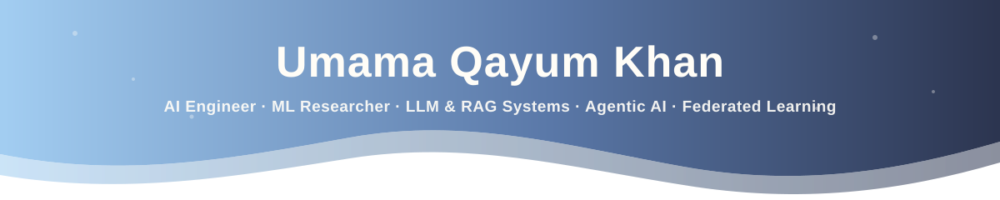
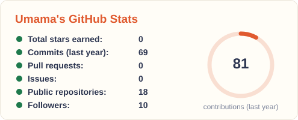
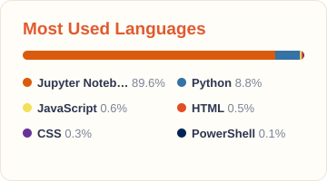
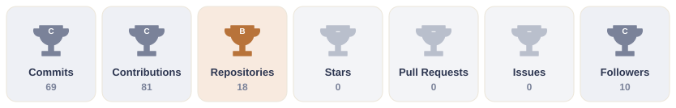
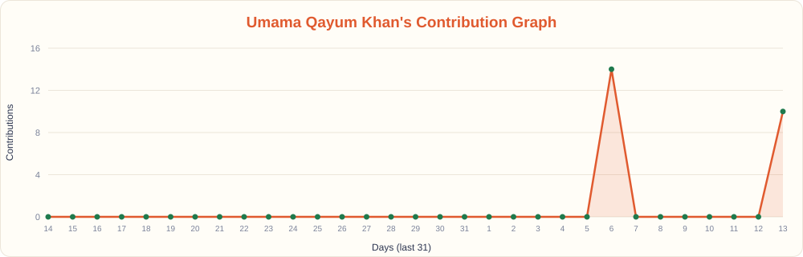

  
  
  

---

## About me

I'm an AI Engineer and machine learning researcher based in Islamabad, Pakistan, and a Computer Science graduate of Iqra University. I'm currently a **Data Science Intern at [10Pearls Pakistan](https://10pearls.com)**.

I work on two sides of the same problem. As an engineer, I build LLM systems meant for production: retrieval-augmented generation with hybrid search and reranking, LangGraph agents with tool calling and human-in-the-loop escalation, MCP servers and n8n AI automations. As a researcher, I study how to make machine learning **private, reliable and honest about what it knows**, especially when the data is sensitive, spread across institutions, or different from what a model was trained on.

What connects both is rigorous evaluation. My projects ship with golden-set eval harnesses, confidence intervals, leak-free validation and CI quality gates, so a claimed improvement has to hold up before I report it.

- 💼 **Now:** Data Science Intern at **10Pearls Pakistan**
- 🔬 **Researching:** privacy-preserving ML, federated learning and reliable computer vision under distribution shift
- 📄 **Paper:** co-authored *Huntington's Disease Detection and Severity Grading Using Federated Learning and Agentic AI*, submitted to AI2ML 2026
- 🧪 **Before:** AI/ML Intern at **KodexByte** (Houston, TX, remote), Junior AI/ML Associate at **Tecwyze SMC / RevivingCare**, and Research Assistant at **Iqra University**
- 🏅 **Certified:** Oracle OCI AI Foundations Associate and OCI Generative AI Professional
- 🤝 **Open to:** AI/ML Engineer roles and research collaborations in healthcare AI and trustworthy ML

---

## 🔬 Research

My research asks two questions: **how can models learn from sensitive, distributed data without exposing it**, and **how do we keep them reliable once real-world data stops looking like the training set?** I'm especially interested in healthcare, where both problems show up at once.

**Research interests**

  
  
  
  
  
  
  

### Research work

**📄 Huntington's Disease Detection and Severity Grading Using Federated Learning and Agentic AI** 
*Co-author · Submitted to the International Conference on Advancement and Innovations in AI and ML (AI2ML 2026)*

A privacy-preserving framework that lets several institutions train a shared model for Huntington's disease detection and severity grading without pooling patient data. It pairs federated learning (FedAvg, FedShape, GPT-FL) with an agentic Actor-Critic layer that supervises training. I designed the Actor-Critic module, which watches client loss, gradient behaviour and convergence stability to support robust aggregation on non-IID, multi-institutional data. I also benchmarked centralised baselines against federated strategies and wrote the methodology and discussion sections.

`Federated Learning` `Agentic AI` `Healthcare AI` `Python` `TensorFlow` `Scikit-learn`

**🔒 Privacy-Preserving Machine Learning** · *Ongoing*

Secure, responsible machine learning for sensitive and distributed data: how intelligent systems can stay useful without compromising the information they learn from.

`Privacy` `Security` `Trustworthy ML`

**🔒 Reliable Computer Vision under Distribution Shift** · *Ongoing*

How deep vision models behave when deployment data differs from their training data, studied through reliability, generalisation, confidence and robustness.

`Computer Vision` `Robustness` `Generalisation` `Deep Learning`

> Methods, datasets and results for ongoing work stay confidential until submission or publication. If you're working on related problems, I'd be glad to talk.

### Research practice in my projects

I apply the same standards to my projects, especially when the honest number is the less flattering one:

- **Leak-free splits:** in the DNA Gene Family Classifier, grouping duplicate sequences brought accuracy from an inflated 90% down to an honest 87.5%
- **Scaffold splitting:** on MoleculeNet BBBP it exposed a +0.073 ROC-AUC inflation from molecular-series leakage, and I added calibration analysis (ECE 0.046)
- **Subject-wise validation:** leave-one-subject-out testing on EEG revealed a 28-point accuracy gap that random-window splits hide
- **Statistical testing:** EvalForge reports bootstrap and Wilson confidence intervals and uses McNemar tests, so a change only counts as an improvement when the evidence supports it

---

## Featured AI engineering projects

| Project | What it does | Stack |
|---|---|---|
| **AtlasRAG** | Production RAG service over enterprise docs. Hybrid Qdrant + BM25 retrieval fused with RRF and LLM reranking, enforced citations, and a CI eval gate that lifted Recall@5 from 0.750 to 1.000 | FastAPI · Qdrant · Groq · Gemini · Docker |
| **SupportGraph** | 8-node LangGraph support agent with verification gating and human-in-the-loop approval. 100% escalation recall and 100% prompt-injection catch rate across 31 failure scenarios | LangGraph · FastAPI · Pydantic |
| **FlowOps** | 4 production n8n workflows (57 nodes) defined as typed Python, a 12-check workflow linter in CI, and a custom MCP server shared by n8n and Claude Desktop | n8n · MCP · Docker · PostgreSQL |
| **EvalForge** | LLM evaluation and regression harness with bootstrap and Wilson intervals, McNemar tests, and an LLM-as-a-Judge validated with Cohen's kappa | Python · Statistics · CI/CD |

## Machine learning projects

| Project | Highlight | Stack |
|---|---|---|
| **Pool Shot Legality Detector** | Fine-tuned YOLOv8s + ByteTrack pipeline that rules an 8-ball shot legal or a foul, shipped as CLI and Gradio app | YOLOv8 · OpenCV · Gradio |
| **DNA Gene Family Classifier** | 87.5% accuracy on 7 gene families with a leak-free grouped split, plus cross-species validation | Scikit-learn · Pandas |
| **Blood-Brain Barrier Classifier** | 0.854 ROC-AUC on MoleculeNet BBBP under scaffold splitting, with calibration (ECE 0.046) | RDKit · XGBoost |
| **BrainStateClassifier** | EEG emotion recognition across 11 models with subject-wise validation and confidence-based abstention | MNE · Streamlit |
| **TeleAgent** | 6-agent telecom ops platform covering anomalies, fraud, sentiment and load forecasting | Streamlit · SHAP · NumPy LSTM |
| **NeuralRecruit** | 5-agent resume screening pipeline with FedAvg and differential privacy | Streamlit · Scikit-learn |
| **NeuroResearch** | 5-agent research assistant over ArXiv, Semantic Scholar and CrossRef with SSE streaming | FastAPI · JavaScript |

---

## Tech stack

**Languages**

  
  
  
  
  
  

**LLM, agents and automation**

  
  
  
  
  
  
  
  

**ML and data**

  
  
  
  
  
  
  
  
  
  
  

**Backend, infra and tools**

  
  
  
  
  
  
  
  
  

---

## GitHub stats

  
  

  

## GitHub trophies

  

## Contribution graph

  

---

**Let's build something reliable.** Reach me at [umamaqayum@gmail.com](mailto:umamaqayum@gmail.com) or on [LinkedIn](https://linkedin.com/in/umama-qayum-khan-770235280).

